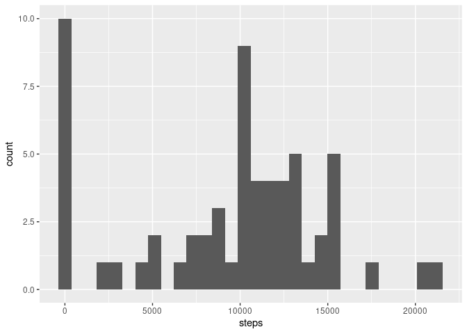
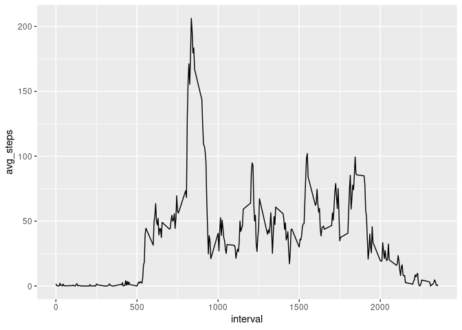
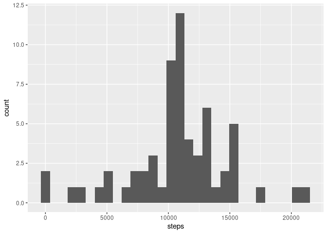
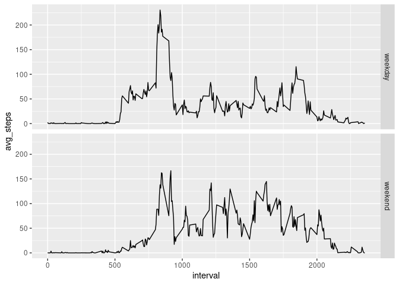

## Loading and preprocessing the data

```r
options(scipen = 999)
activity_raw <- read.csv("activity.csv")
```


## What is mean total number of steps taken per day?

```r
library(tidyverse)
```

```
## ── Attaching packages ──────────────────────────────────────────────────────────────────────────────────────────────────────────────────────────────────── tidyverse 1.3.0 ──
```

```
## ✓ ggplot2 3.3.1     ✓ purrr   0.3.4
## ✓ tibble  3.0.1     ✓ dplyr   1.0.0
## ✓ tidyr   1.1.0     ✓ stringr 1.4.0
## ✓ readr   1.3.1     ✓ forcats 0.5.0
```

```
## ── Conflicts ─────────────────────────────────────────────────────────────────────────────────────────────────────────────────────────────────────── tidyverse_conflicts() ──
## x dplyr::filter() masks stats::filter()
## x dplyr::lag()    masks stats::lag()
```

```r
total_steps <- activity_raw %>%
  group_by(date) %>%
  summarize(steps = sum(steps, na.rm= TRUE),
            .groups = "drop")

total_steps %>%
  ggplot(aes(x=steps)) +
  geom_histogram(bins = 30)
```

<!-- -->

```r
mean_steps <- mean(total_steps$steps)
med_steps <- median(total_steps$steps)
```

The daily mean number of steps is 9354, and the daily median number of steps is 10395

## What is the average daily activity pattern?


```r
daily_steps <-
  activity_raw %>%
  group_by(interval) %>%
  summarize(avg_steps = mean(steps, na.rm = TRUE),
            .groups = "drop")

daily_steps %>%
  ggplot(aes(x = interval, y = avg_steps)) +
  geom_line()
```

<!-- -->

```r
max_interval <- daily_steps$interval[which.max(daily_steps$avg_steps)]
max_avg_steps <- daily_steps$avg_steps[which.max(daily_steps$avg_steps)]
```

The 5 minute interval with the most steps on average is 835 with 206.1698113 steps.

## Imputing missing values


```r
total_na_steps <- sum(is.na(activity_raw$steps))
mean_na_steps <- mean(is.na(activity_raw$steps))

# Imputing step:
# Attach the daily average steps per interval, select the imputed value if the 
# original is NA, and remove all working columns
activity_imputed <- activity_raw %>%
  left_join(daily_steps, by = "interval") %>%
  mutate(steps_new = coalesce(steps, avg_steps)) %>%
  select(steps = steps_new, date, interval)

total_steps_imputed <- activity_imputed %>%
  group_by(date) %>%
  summarize(steps = sum(steps),
            .groups = "drop")

total_steps_imputed %>%
  ggplot(aes(x=steps)) +
  geom_histogram(bins = 30)
```

<!-- -->

```r
mean_steps_imp <- mean(total_steps_imputed$steps)
med_steps_imp <- median(total_steps_imputed$steps)
```

There are a total of 2304 (13%) intervals missing step data. After imputing the missing number of steps with the daily average for that interval, we see that the mean number of steps per day increases from 9354 to 10766 (an increase of 1412) and the median number of steps per day increases from 10395 to 10766 (an increase of 371).

## Are there differences in activity patterns between weekdays and weekends?


```r
activity_imputed <- activity_imputed %>%
  mutate(weekend = weekdays(as.Date(date)) %in% c("Saturday", "Sunday")) %>% # Boolean TRUE if weekend day
  mutate(weekday = if_else(weekend, "weekend", "weekday")) %>%
  mutate(weekday = as.factor(weekday))

daily_steps_imp <-
  activity_imputed %>%
  group_by(interval, weekday) %>%
  summarize(avg_steps = mean(steps), # not using na.rm=TRUE because the data should have no NAs.
            .groups = "drop")

daily_steps_imp %>%
  ggplot(aes(x = interval, y = avg_steps)) +
  geom_line() +
  facet_grid(rows = vars(weekday))
```

<!-- -->
